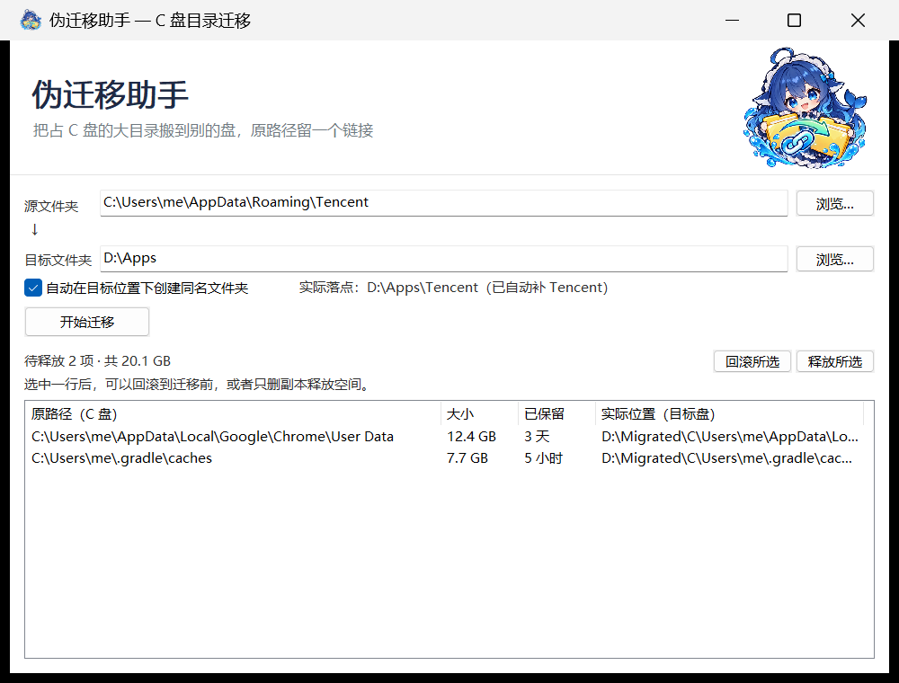

# 伪迁移助手

[English](README.en.md) | **简体中文**

> 把占 C 盘的大目录搬到别的盘，原位置留一个目录联接（Junction）。
> 程序照旧用原来的路径读写，数据已经躺在目标盘上。



## 它解决什么问题

C 盘越来越满，但很多目录**删不得**：程序配置、本地缓存、聊天记录、游戏资源……
删了程序就崩，留着又动辄几十 GB。

这个工具把目录整体搬到别的盘，然后在 C 盘原位置建一个 **Junction（目录联接）**：

```
迁移前   C:\Users\me\AppData\Roaming\Tencent          ← 真实目录，4.2 GB
迁移后   C:\Users\me\AppData\Roaming\Tencent          ← 一个链接，0 字节
                              └──> D:\Apps\Tencent    ← 真实数据在这
```

程序打开 `C:\Users\me\AppData\Roaming\Tencent` 时，系统自动把它导向 `D:\Apps\Tencent`。
**程序完全无感，配置不会丢，C 盘空间真的回来了。**

名字里的"伪"就是这个意思：不是真的搬走，是让系统以为它还在。

## 特性

- **单文件 exe**，约 2.4 MB，无 .NET 运行时依赖，拷到哪都能跑
- **五步提交**：复制 → 校验 → 换位 → 建链 → 探针，任何一步失败都自动恢复原样
- **原样重建目录联接**，不会把链接指向的内容重复复制一份
- **备份 + 待释放列表**：迁移后原数据保留一份，随时可以秒级回滚
- 处理了只读文件、稀疏文件、长路径、文件占用这些实际会踩的坑

## 工作原理

```
① 复制     复制到 <目标>.__incoming__，不直接写正式名
② 校验     逐文件比对大小 + 修改时间，不一致就中止
③ 换位     incoming 改成正式名 → 原目录改名成 xxx.__bak_时间戳
④ 建链     在原位置创建 Junction 指向目标
⑤ 探针     通过 C 盘路径写一个文件，确认它出现在目标盘，然后删掉
```

- ① ② 失败：删掉临时副本，源目录**一个字节都没动**
- ④ ⑤ 失败：删链接、把 `.bak` 改回原名，自动回滚
- 全部成功后：原数据以 `.__bak_*` 形式保留，出现在「待释放」列表

回滚**不需要重新复制**——只是删链接 + 改个名，毫秒级完成。

## 使用

1. 从 [Releases](../../releases) 下载 `伪迁移助手.exe`
2. 双击运行（可能被 SmartScreen 拦一次，见下方 FAQ）
3. **源文件夹**：要搬走的目录
4. **目标文件夹**：放在哪个目录下（勾选"自动补同名文件夹"时，`D:\Apps` 会变成 `D:\Apps\Tencent`）
5. 点「开始迁移」
6. 正常使用这个程序几天，确认没问题后，回到主界面选中那一行 → **释放所选**（删掉备份，真正腾出空间）

如果发现异常 → **回滚所选**，一切恢复原状。

## 从源码构建

需要 **.NET 8 SDK** 和 **Visual Studio 2022 生成工具**（NativeAOT 要用到 C++ 链接器）。

```powershell
.\build.ps1
```

产物：`src\c2d\out\伪迁移助手.exe`，单文件。

## 已知限制

| 限制 | 说明 |
|---|---|
| 目标必须是**固定磁盘** | 移动硬盘拔掉或盘符变了，链接会失效 |
| 目录被占用时改不了名 | 程序会逐层排查并指出是哪个子项 |
| 目标程序不支持长路径 | 迁移后路径变长可能打不开（只在路径变长时警告） |
| 迁移后别手工改动 `.bak` 名字 | 待释放列表会找不到它 |
| 只支持当前用户可读写的目录 | 需要 SYSTEM 权限的目录会预检失败 |

## 常见问题

**迁移时提示"改不了名"？**
目录里有文件被别的程序开着。Windows 允许你读这些文件，但不允许给目录改名。
按提示关掉对应程序（微信/QQ 要退出托盘图标），或者重启后第一时间迁移。

**为什么迁移完还要点一次"释放"？**
留一份备份是你最后的安全网。确认程序正常后再删，删了就不能回滚了。

## 许可证

[MIT](LICENSE)
